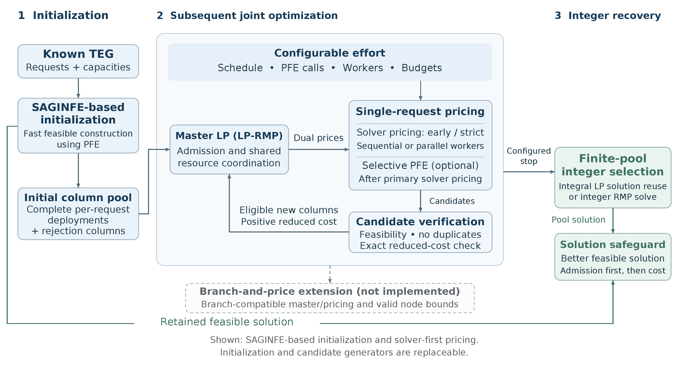

# SAGIN-SFC-deployment-heuristic-assisted-CG

Technical companion to **Scalable Full-Horizon SFC Deployment over Predictable SAGIN Topologies via Configurable Column Generation Framework**.

**Authors:** Hang Li, Hao Huang, Yihu Xu, Zixuan Kong, and Yanling Jin.

**Paper:** [arXiv:2611.09585](https://arxiv.org/abs/2611.09585) | [DOI: 10.48550/arXiv.2611.09585](https://doi.org/10.48550/arXiv.2611.09585)

This research repository studies admission and ordered service function chain (SFC) deployment in a space–air–ground integrated network (SAGIN). A time-expanded graph (TEG) represents communication, computation, and waiting across a known planning horizon. Complete request deployments become columns; a master problem coordinates their competition for shared resources.

The implementation connects fast SAGIN Flow Embedding (SAGINFE), stage-wise Per-Flow Embedding (PFE), Dantzig–Wolfe column generation, configurable pricing, parallel request pricing, and final integer selection over the generated pool. The objective gives admission priority and then minimizes normalized resource consumption. **Finite-pool integer optimality is not global integer optimality of the original deployment problem.**

[](figures/paper/framework_overview.pdf)

The dashed branch indicates a potential branch-and-price extension that is not implemented.

## Read the companion

| Document | Contents |
|---|---|
| [Mathematical model](docs/model/README.md) | Temporal assumptions, complete essential constraints, objective, decomposition, duals and reduced costs |
| [Algorithms](docs/algorithms/README.md) | Construction, pricing policies, parallel execution, integer recovery and safeguards |
| [Experimental protocol](docs/experiments/README.md) | Topology and traffic generation, exact settings, campaign configurations and commands |
| [Results and figure guide](docs/experiments/results.md) | Manuscript results and supplementary studies |
| [Reproducibility](docs/reproducibility.md) | Dependencies, tests, outputs, licensing and reproducibility limits |

## Quick start

Run from the repository root. Python 3.8.10 is the locally tested interpreter; solver dependencies and hardware are described in the reproducibility notes.

```powershell
git clone https://github.com/flgkd/SAGIN-SFC-deployment-heuristic-assisted-CG.git
cd SAGIN-SFC-deployment-heuristic-assisted-CG
python -m venv .venv
.venv\Scripts\Activate.ps1
python -m pip install -r requirements.txt
python examples/smoke.py
python -m pytest tests -q
```

The example builds and validates a small synthetic instance, constructs a SAGINFE solution, and checks its aggregate capacities. The base workflow needs neither Gurobi nor a license. A few controller tests import solver modules; they are explicitly skipped when `gurobipy` is absent. They run without optimization or a license when the package is installed.

Optional ILP, RMP and pricing integration tests require the solver package and a functioning Gurobi license:

```powershell
python -m pip install -r requirements-solver.txt
$env:RUN_GUROBI_TESTS = '1'
python -m pytest tests tests_gurobi -q -rs
```

`tests_gurobi` is skipped without the opt-in flag, the package, or a usable license; `-rs` shows skip reasons. Skipped tests have not validated solver behavior. A size-limited license may support these tiny tests but not full experiments.

Run a **new** filtered SAGINFE experiment and plot its output:

```powershell
python run_formal_benchmark.py --plan configs/formal/formal_scale_load_master_v3.json --output outputs/example --algorithms saginfe --scales S20 --loads Low --seeds 0 --yes
python scripts/plot/plot_new_results.py --input outputs/example/runs.jsonl --output generated/example
```

The formal runner expects a committed working tree. For deliberate local edits use its explicit `--allow-dirty` flag. Full campaigns can be expensive; the quick example is the first execution check.

## Repository map

| Location | Purpose |
|---|---|
| Root Python modules | Existing imports and science-critical solver implementations |
| `configs/formal/` | Executable plans for the experimental protocol |
| `configs/pilot/`, `configs/preflight/`, `configs/templates/` | Diagnostic fixtures and versioned templates; see the configuration reference for scope |
| `examples/` | Small construction and validation example |
| `scripts/` | Specialized campaign runners and aggregation programs |
| `scripts/plot/` | Plotting new outputs and source scripts for manuscript figures |
| `figures/paper/` | All 13 PDF assets actually used in the paper, plus PNG previews |
| `figures/supplementary/` | Final supplementary PDFs and high-resolution previews |
| `tests/`, `tests_gurobi/` | Unit tests and license-dependent solver tests |
| `docs/` | Model, algorithms, experiments and reproduction instructions |

## Terminology and reported results

The decomposition uses Dantzig-Wolfe column generation (DWCG). The main configurations are DWCG-Pure (Pure), DWCG-SAGINFE (HFP), and DWCG-SAGINFE-PRO (PRO).

The manuscript reports PRO improving its SAGINFE initialization on all 120 main instances: more admissions on 73, and equal admission with lower cost on 47. It reports up to 2.69× median pricing-stage speedup with four workers. See [Results](docs/experiments/results.md) for the comparison sets and experimental scope.

Formal experiments use no overall end-to-end runtime limit. Intrinsic CG/pricing budgets and the independent 300-second integer-RMP cap are specified in the [experimental protocol](docs/experiments/README.md).

Per-seed numerical records and solver logs are not distributed. Configurations and programs support synthetic replication and plotting new outputs. Exact reconstruction of the supplied figures requires the original numerical records; the PDFs preserve the reported results.

## Citation

If you use the algorithms, implementations, or experimental results in this repository, please cite the associated paper. Citation metadata is provided in [CITATION.cff](CITATION.cff).

## License

The source code, algorithm implementations, executable and plotting scripts, tests, examples, and executable configurations are licensed under the MIT License (see [LICENSE](LICENSE)).

The original documentation and figures are licensed under the Creative Commons Attribution 4.0 International License (CC BY 4.0; see [LICENSE-CONTENT](LICENSE-CONTENT) for attribution and exceptions).

Third-party materials, including Gurobi, remain subject to their respective licenses.
