# Results and figure guide

[Protocol](README.md) · [Model](../model/README.md) · [Algorithms](../algorithms/README.md)

This page presents the results reported in the manuscript and the selected final supplementary packages. Numerical summaries refer to those figures and their stated comparison sets. Original PDFs and high-resolution PNG previews are preserved. Source paths and original PDF hashes are recorded in the [source manifest](../source-manifest.json).

Pure denotes DWCG-Pure, HFP denotes DWCG-SAGINFE, and PRO denotes DWCG-SAGINFE-PRO. Figures use $|R|$ consistently for request count.

## 1. Model and algorithm illustrations

| Asset | Explanation |
|---|---|
| [SAGIN example](../../figures/paper/SAGIN_example.pdf) | Ordered processing, communication and waiting over a three-slot illustrative TEG; not experimental evidence |
| [Framework](../../figures/paper/framework_overview.pdf) | Initialization, LP master, request pricing, verification, integer recovery and safeguard; dashed branch-and-price is unimplemented future work |
| [PFE stages](../../figures/paper/PFE_illustration.pdf) | One retained record per candidate location, connected by complete TEG routes; the heuristic pruning is not exact dynamic programming |

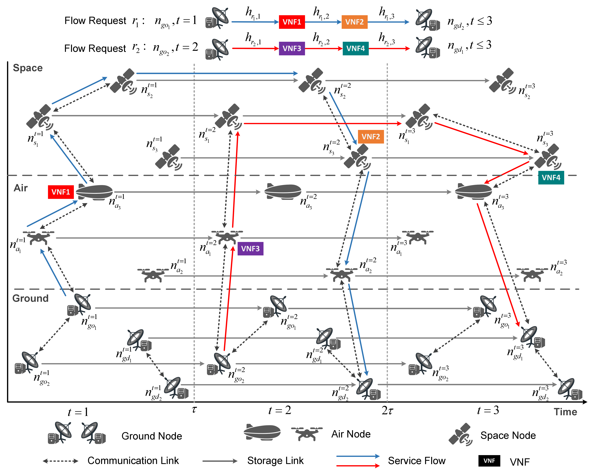

## 2. Admission across scales and loads

**Question:** How do construction and finite-pool optimization trade admission quality across S20–S50 and three loads?

[Manuscript PDF](../../figures/paper/main_scaling_acceptance.pdf)

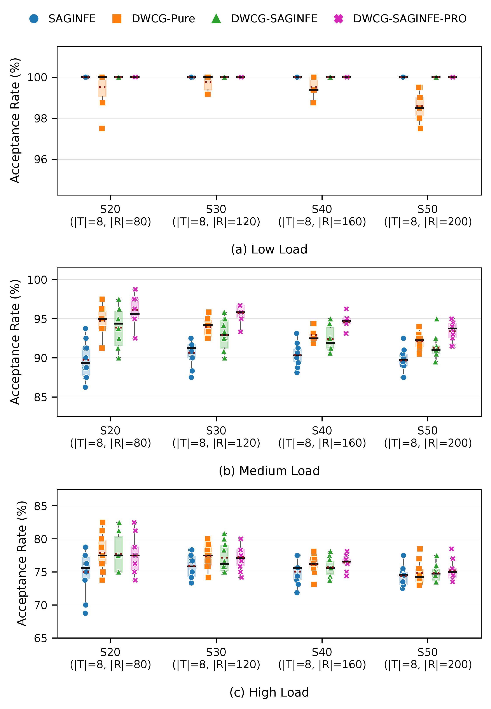

The scale-load master plus PRO extension supplies ten paired instances per setting. In the reported figure, SAGINFE, HFP and PRO admit all requests at Low load; Pure occasionally falls short, reaching 98.60% mean admission at S50. At Medium load, PRO has the highest reported mean admission: 96.13%, 95.75%, 94.56% and 93.40% at S20–S50. Its mean improvements over SAGINFE are 5.1, 6.1, 6.7 and 7.5 admitted requests. At High load, Pure is slightly higher at S20/S30 and PRO at S40/S50. There is no universal ordering across loads.

Relative to its own initialization, PRO increases admission on 73 main instances and retains admission with lower cost on the remaining 47. All 120 returned results in this comparison come from final integer selection. This establishes the reported empirical improvement under these configurations; it is not a proof of global optimality or universal strict improvement.

Configuration: [master](../../configs/formal/formal_scale_load_master_v3.json), [PRO](../../configs/formal/formal_dwcg_saginfe_pro_v3.json). Historical plotting source: `generate_main_scaling_final_figures.py` in [plot archive](../../scripts/plot/README.md). See the [protocol](README.md#4-campaigns-and-executable-configurations) for executable settings.

## 3. Certified ILP comparisons

**Question:** How far do practical finite searches remain from available admission and cost certificates?

| Panel | Final PDF | Scope |
|---|---|---|
| Admission | [acceptance](../../figures/paper/acceptance_exact_quality.pdf) | S20/S30 Low and Medium; ten instances per available method |
| Runtime | [runtime](../../figures/paper/runtime_exact_quality.pdf) | Same available comparisons, logarithmic time axes |
| Cost including Pure | [all methods](../../figures/paper/cost_exact_quality_all5.pdf) | Six methods, seven common full-admission Low seeds per scale; filename is historical |
| Cost excluding Pure | [without Pure](../../figures/paper/cost_exact_quality_no_pure.pdf) | Five methods, all ten Low seeds per scale |

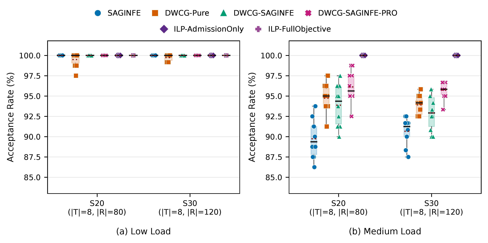

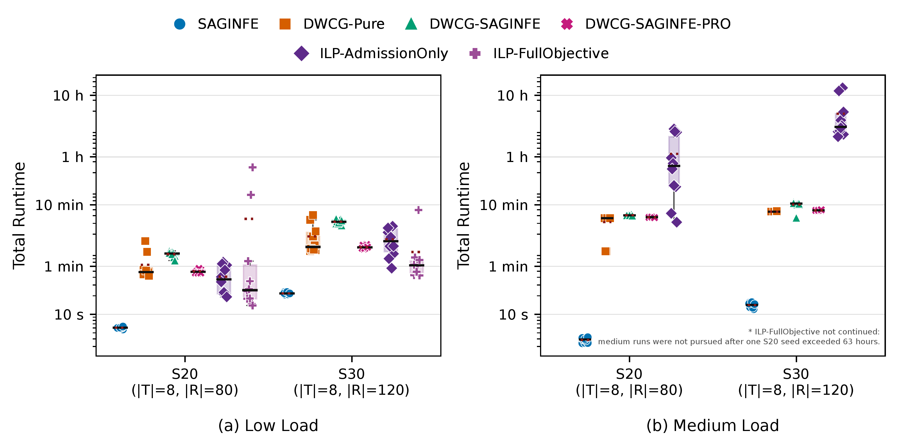

Admission-only ILP certifies 100% admission on all tested S20/S30 Low and Medium instances. Full-objective ILP is certified on Low only. PRO's Medium mean admitted counts are 76.9/80 and 114.9/120, leaving mean gaps of 3.1 and 5.1 requests (3.88 and 4.25 percentage points). Finite-pool search improves construction without closing these admission gaps.

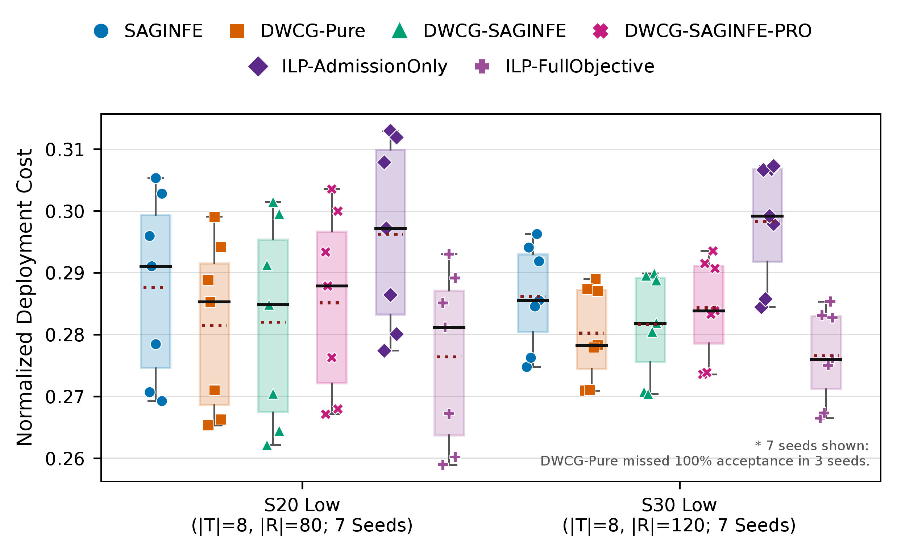

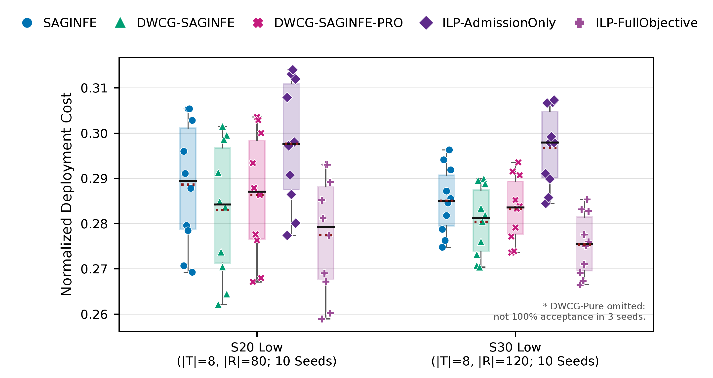

The seven-seed panel conditions on all methods admitting every request. Pure's median costs are 0.2853 (S20) and 0.2783 (S30), compared with 0.2812 and 0.2760 for full-objective ILP. The other three seeds per scale remain in admission/runtime comparisons. In the ten-seed S30 panel, mean costs are 0.2851 for SAGINFE, 0.2832 for PRO, 0.2804 for HFP and 0.2754 for full-objective ILP. Admission-only ILP has mean cost 0.2967, illustrating the distinction between admission certification and cost optimization. Means and medians from different eligible seed sets must not be conflated.

Low-load full-objective ILP median times are 24.7 and 62.3 seconds at S20/S30; PRO uses 49.0 and 122.1 seconds, and SAGINFE 6.1 and 21.9 seconds. Medium admission-only certification takes median 2561.1 and 11094.7 seconds, compared with PRO's 378.2 and 488.1 seconds. A diagnostic S20 Medium full-objective run exceeded 63 hours without completion; it is excluded and provides no certificate.

Configuration references: [protocol's exact-reference rows](README.md#4-campaigns-and-executable-configurations). Plot archive: `generate_final_review_split_ilp.py`. The historical filenames do not define eligibility; the caption and manuscript do.

## 4. Computational scaling

**Question:** What is the complete algorithm cost as network scale increases?

[Manuscript PDF](../../figures/paper/main_scaling_runtime_log.pdf)

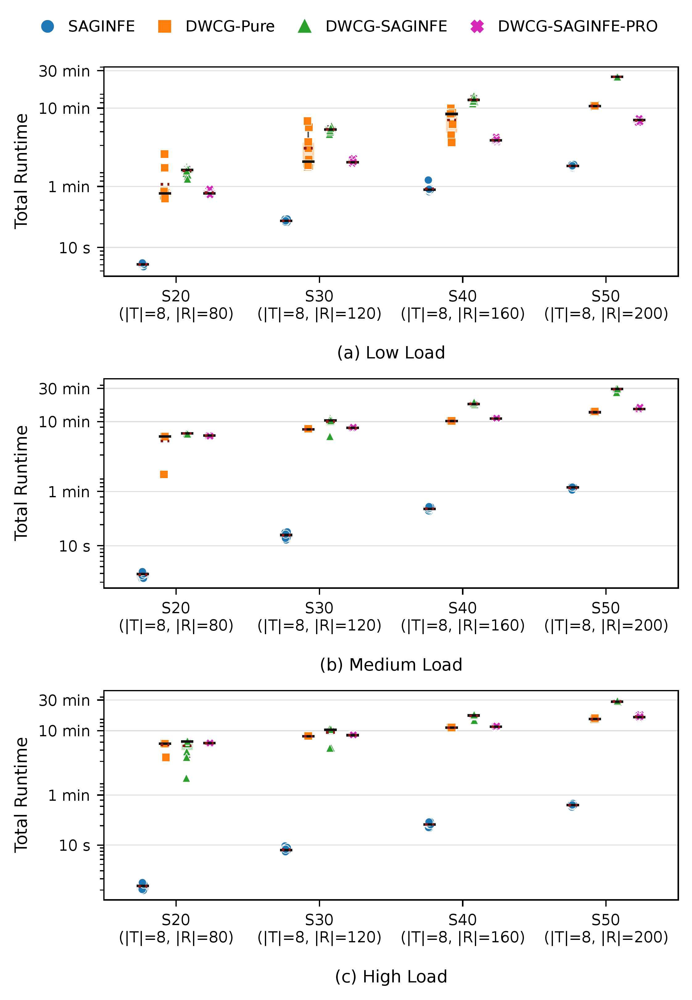

SAGINFE is the fastest construction method in the reported main comparisons. At S50 Medium, median end-to-end times are 68.6 seconds for SAGINFE, 818.3 for Pure, 906.7 for PRO and 1769.2 for HFP. At S40 Low, PRO reaches full admission in median 232.2 seconds versus Pure's 504.0 seconds. Runtime includes initialization and recovery, so these are not isolated pricing or Gurobi solve times. Use the same master/PRO provenance as the admission figure.

## 5. Fixed-request temporal control

**Question:** Does a larger supplied TEG impose overhead when usable request windows stay fixed?

[Final PDF](../../figures/paper/same_flow_temporal_control_s40_1x2.pdf)

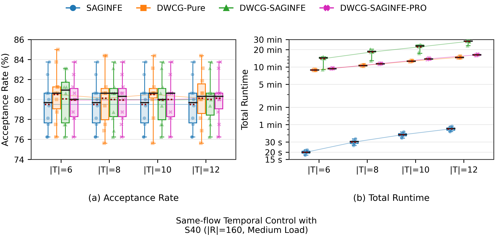

At S40 Medium, all 160 requests and their service windows are fixed within the first six slots while the supplied horizon grows 6→12. Time nodes double 240→480. PRO's mean admitted count changes only from 127.9 to 128.2, while median runtime increases approximately 562→977 seconds. Pure increases 532→881 seconds and HFP 868→1690 seconds. The implemented model construction includes the supplied TEG, so extra copies increase work even outside request windows.

This is a control of supplied model size, not extra scheduling flexibility or a cross-horizon cost study. Configuration: [same-flow plan](../../configs/formal/formal_same_flow_temporal_control_v3.json) and [HFP extension](../../configs/formal/formal_same_flow_temporal_control_hfp_extension_v3.json); launcher `run_same_flow_temporal_control_v3.py`. The GitHub figure uses the side-by-side export; the archived stacked variant was formatted for the paper page.

## 6. Pricing schedules

**Question:** How does the strict/early search schedule affect admission and runtime under the same logical work allowance?

[DWCG-Pure PDF](../../figures/paper/pricing_schedule_tradeoff_1x2.pdf) · [DWCG-SAGINFE-PRO PDF](../../figures/paper/pro_pricing_schedule_tradeoff_1x2.pdf)

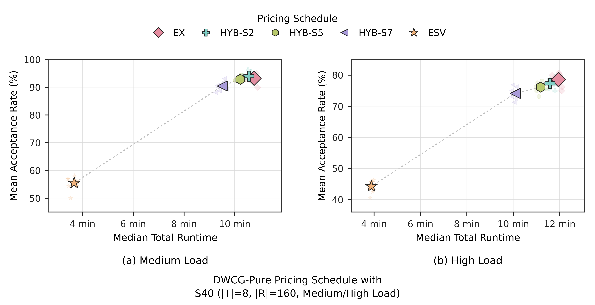

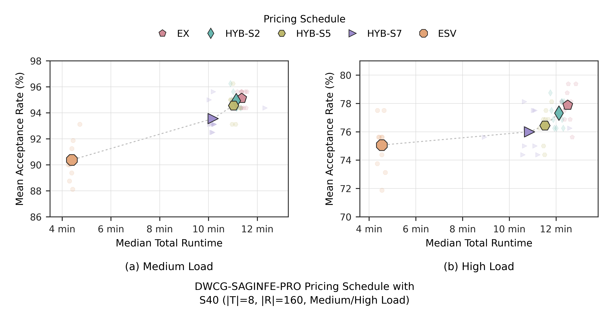

The S40 Medium/High experiment compares EX, ESV and HYB-S2/S5/S7, ten instances each. Reported runs complete 12 rounds and 1920 primary pricing calls and stop at their work allowance; this is not full-master LP convergence. Large points show mean admission against median end-to-end time; faint points are individual instances.

At Medium, Pure-ESV admits 88.7 requests in median 220.5 seconds, versus Pure-EX's 149.1 in 645.5 seconds. With PRO initialization and safeguards, ESV admits 144.6 in 263.7 seconds, and EX 152.2 in 681.5 seconds. Hybrid schedules offer intermediate operating points but are not monotonically ordered: Pure-HYB-S2 admits 150.4 at Medium, more than Pure-EX. More exact pricing changes the finite pool and does not ensure superior time-limited integer recovery.

ESV's small pools have sub-second median final-RMP time; EX and hybrids typically consume the integer-recovery allowance. Thus runtime differences reflect both candidate generation and final selection. Configuration: [Pure](../../configs/formal/formal_pricing_schedule_v3.json), [PRO](../../configs/formal/formal_pro_pricing_schedule_v3.json); corresponding `run_*pricing_schedule_v3.py` launchers and stacked tradeoff sources in the [archive](../../scripts/plot/README.md).

## 7. Component configurations and supplementary S40/S50 distributions

**Question:** Are initialization, heuristic pricing and selective PFE consistently beneficial?

The manuscript's S40 table reports the following mean admitted counts and median end-to-end seconds, over ten paired instances with 160 requests:

| Configuration | Low admitted / seconds | Medium admitted / seconds | High admitted / seconds |
|---|---:|---:|---:|
| Pure | 159.2 / 504 | 148.6 / 613 | 121.8 / 670 |
| Warm | 160.0 / 230 | 151.3 / 625 | 122.4 / 643 |
| HP | 152.3 / 711 | 149.1 / 1242 | 124.4 / 1238 |
| HFP | 160.0 / 763 | 147.8 / 1068 | 121.1 / 1037 |
| PRO-no-PFE | 160.0 / 227 | 151.9 / 622 | 122.5 / 645 |
| PRO | 160.0 / 232 | 151.3 / 661 | 122.3 / 691 |

Supplementary figures preserve full distributions omitted from the paper's table:

| Scale | Admission PDF | Runtime PDF |
|---|---|---|
| S40 | [zoomed admission](../../figures/supplementary/component_ablation_s40_acceptance_zoomed_final.pdf) | [runtime](../../figures/supplementary/component_ablation_s40_runtime_final.pdf) |
| S50 | [zoomed admission](../../figures/supplementary/component_ablation_s50_acceptance_zoomed_final.pdf) | [runtime](../../figures/supplementary/component_ablation_s50_runtime_final.pdf) |

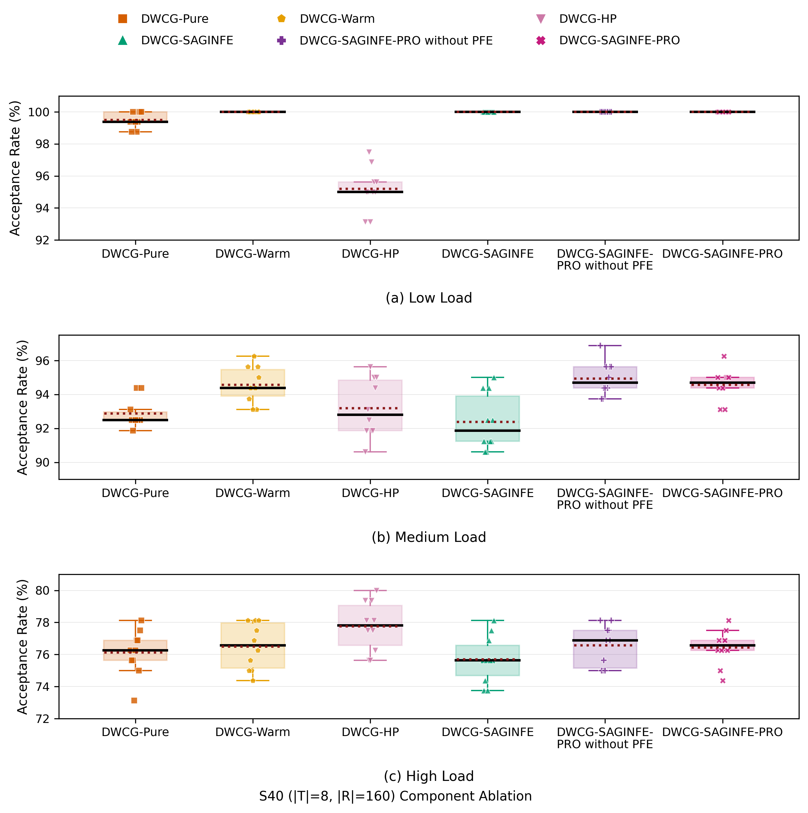

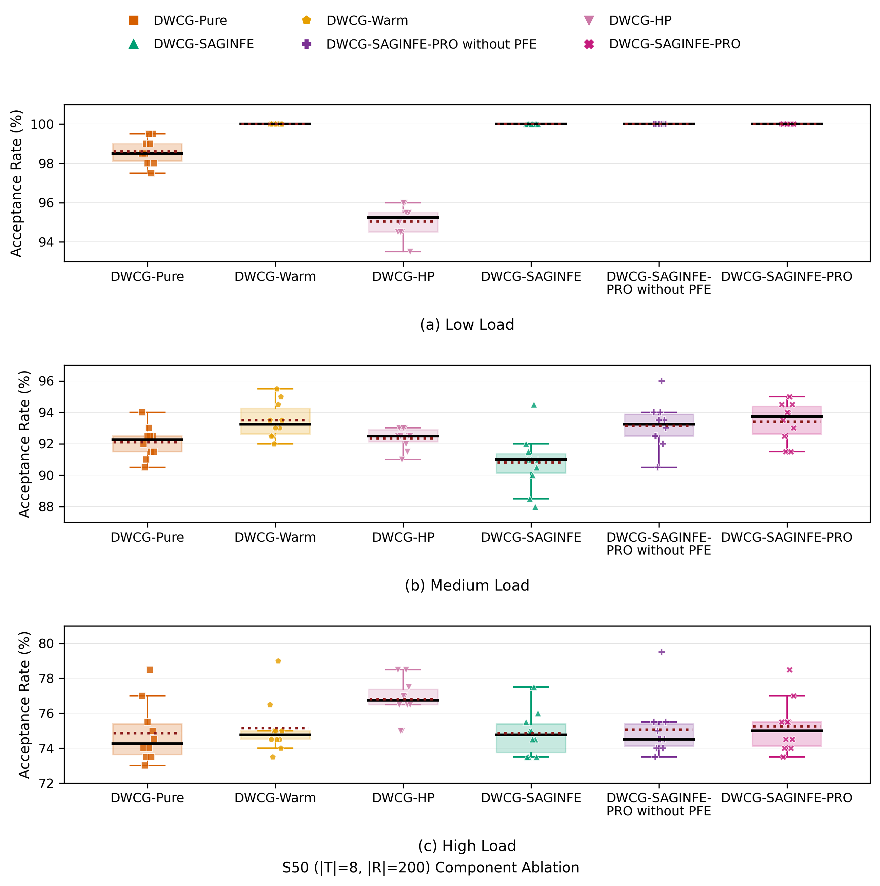

Warm improves Pure's mean admission at all S40 loads and substantially reduces Low runtime. HP achieves the highest S40 High mean admission but approximately doubles Pure's runtime and performs worse at Low. Component effects are not additive. Selective PFE changes S40 Medium/High mean admission by −0.6/−0.2 versus PRO-no-PFE, while the corresponding S50 changes are +0.5/+0.4, with additional runtime. At full-admission initialization, PFE is not called; small Low-load timing differences cannot be attributed to PFE.

The component figures use the selections from the `final_bundle/s40` and `final_bundle/s50` packages. Their [input fingerprints and reconstruction command](../../scripts/plot/README.md#supplementary-figures) preserve these selections. S50 combines 90 baseline and 90 extension rows paired by instance fingerprints. Each package defines its own plotted selection; the S50 component package and main scaling package are not interchangeable inputs. The variants are not a strictly monotone component ladder. Configurations: [S40](../../configs/formal/formal_component_ablation_s40_v3.json), [S50](../../configs/formal/formal_component_ablation_s50_extension_v3.json); component launchers and `generate_component_ablation_*` archive sources.

## 8. Parallel pricing and supplementary absolute runtime

**Question:** How much of primary-pricing speedup reaches the complete algorithm?

[Paper speedup PDF](../../figures/paper/parallel_pricing_speedup_1x2.pdf) · [Supplementary runtime PDF](../../figures/supplementary/parallel_pricing_runtime_final.pdf)

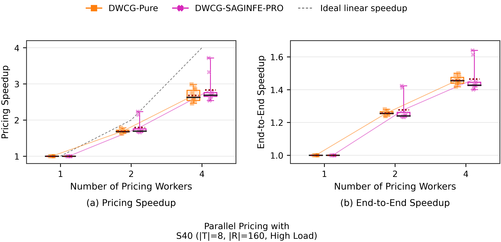

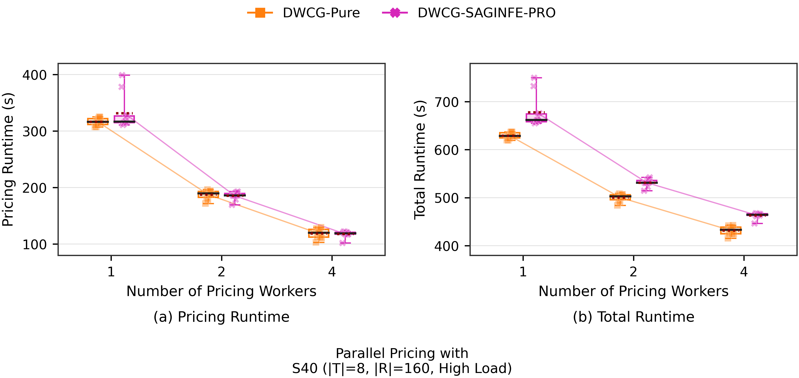

At S40 High, Pure and PRO use 1/2/4 pricing workers with one solver thread per worker. Four-worker median pricing speedups are 2.63 and 2.69; end-to-end speedups are 1.45 and 1.43. Median total times decrease 629.0→433.2 seconds for Pure and 662.0→464.5 for PRO. Paired admitted counts and ordered final pools remain equal across worker counts in this study.

Initialization, LP masters, selective PFE and integer recovery remain serial; final integer selection stays near 302 seconds and limits whole-algorithm acceleration. The supplemental frozen runtime figure shows absolute wall-clock times, not CPU time. High load was selected as a challenging engineering point; it is not claimed to be the most representative real deployment. Configuration: [parallel plan](../../configs/formal/formal_parallel_pricing_v3.json), launcher `run_parallel_pricing_v3.py`, archive `generate_parallel_pricing_*`.

## 9. Supplementary deadline sensitivity

**Question:** How does temporal flexibility affect feasible admission at fixed scale and load?

[Final PDF](../../figures/supplementary/deadline_sensitivity_s40_final.pdf)

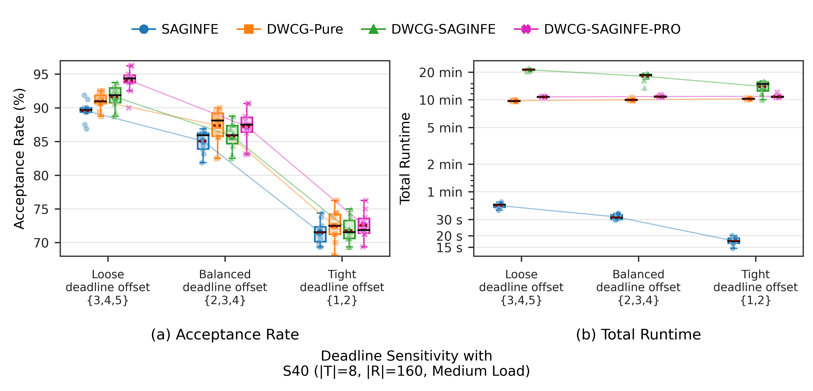

The final corrected freeze uses S40, eight slots, 160 requests, Medium load and ten paired seeds for each method/profile. The display order is Loose→Balanced→Tight, corresponding to offsets {3,4,5}, {2,3,4}, and {1,2}. The frozen package supports paired monotonic admission degradation for all four methods, with PRO benefiting strongly from loose windows. It does not support universal PRO dominance or the claim that wider deadlines always reduce runtime. Offsets are not inclusive window lengths.

Provenance: scientific freeze `deadline-sensitivity-s40-v3-final`, corrected mean/median layering figure freeze. Configuration: [deadline plan](../../configs/formal/formal_deadline_sensitivity_s40_v3.json); `run_deadline_sensitivity_s40_v3.py` and `generate_deadline_sensitivity_s40_final.py`.

## 10. Supplementary operational temporal expansion

**Question:** What happens when the operational horizon and its request timing expand together?

[Final PDF](../../figures/supplementary/operational_temporal_scalability_s40_final.pdf)

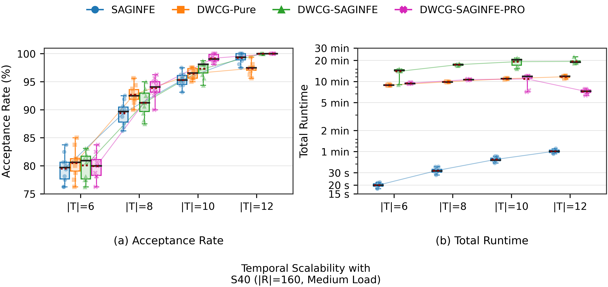

The frozen operational study uses S40 Medium, 160 requests, horizons 6/8/10/12 and ten paired seeds per algorithm. Admission generally rises with operational expansion; PRO reaches full admission at 12 slots. The finite-budget results show strong PRO admission at eight and ten slots, and substantially lower runtime than HFP at twelve slots.

Request timing changes according to the paired operational builder. This is distinct from the fixed-request control above and cannot establish that adding graph slots alone caused all admission gains. Neither strict monotonicity for every method/seed nor uniform PRO dominance is asserted. Cross-horizon normalized costs are not compared.

Provenance: `temporal-scalability-v3-final` scientific freeze and final S40 figure package. Configuration: [temporal plan](../../configs/formal/formal_temporal_scalability_v3.json), launcher `run_temporal_scalability_v3.py`, archive `generate_temporal_scalability_s40_final.py`.

## 11. Reproduction boundary

The supplied figures preserve the manuscript and selected supplementary results. Per-seed records and frozen numerical tables are not distributed. Exact reconstruction requires the original records and the selection logic in the [plotting sources](../../scripts/plot/README.md). The [new-output plotter](../../scripts/plot/plot_new_results.py) supports results from new executions of the supplied methods; those executions should retain their own settings and fingerprints.
